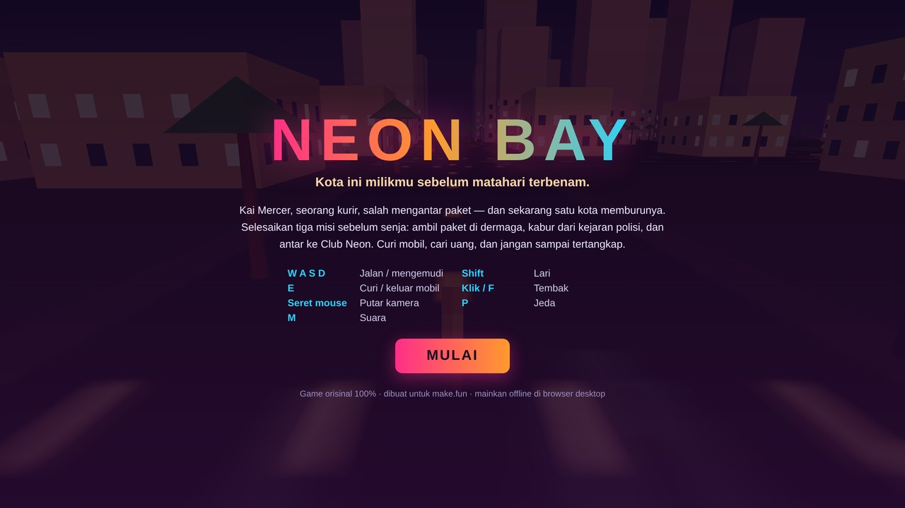
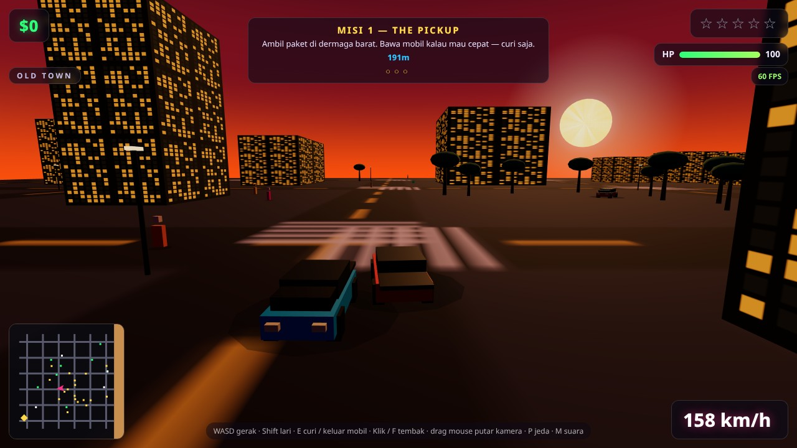
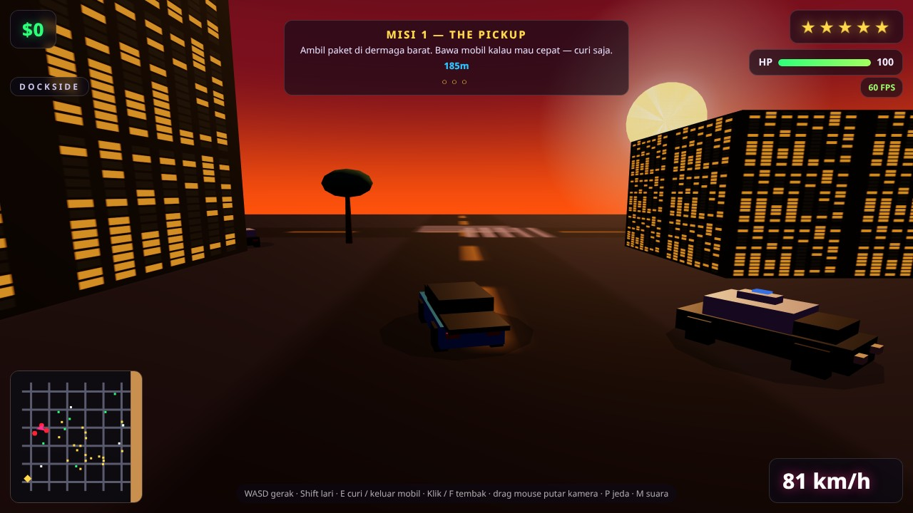
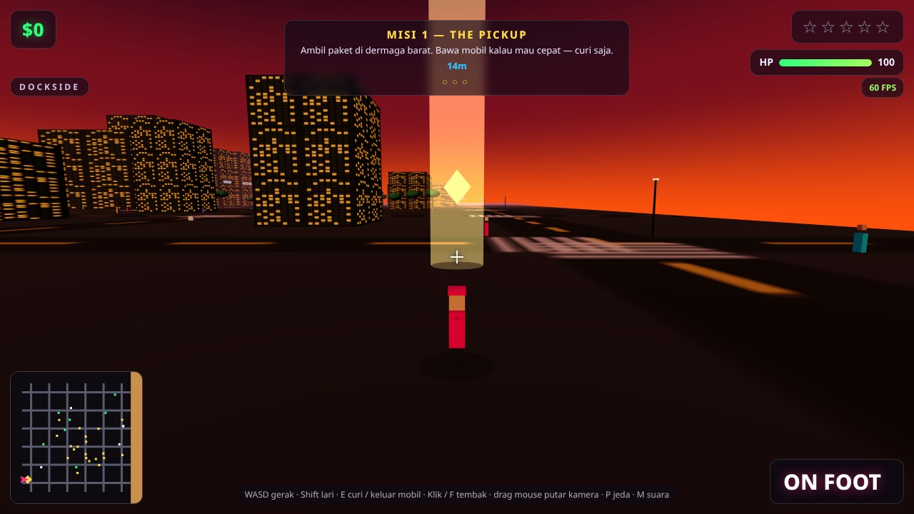

# NEON BAY — Open-World Crime Game

[](https://make.fun/bounty/gta6-01?utm_source=github&utm_medium=readme&utm_campaign=gta6-01)
[](https://make.fun/bounty/gta6-01/leaderboard?utm_source=github&utm_medium=readme&utm_campaign=gta6-01)
[](https://make.fun/bounty/gta6-01?utm_source=github&utm_medium=readme&utm_campaign=gta6-01)

**NEON BAY** is a complete open-world crime game built for the make.fun bounty
["Make GTA 6"](https://make.fun/bounty/gta6-01): a sun-soaked coastal city you
explore on foot and by car, with traffic, pedestrians, a 5-star wanted system,
police chases, a 3-mission story, combat, a taxi side job, and a full HUD with
minimap. It runs entirely offline in a desktop browser — zero network
requests, no downloads, no assets beyond the files in this repo.

You are **Kai Mercer**, a courier who delivered the wrong package. Now the
whole city is after you: steal a car, lose the cops, and deliver the last
package to **Club Neon** before the sun goes down.

## Screenshots

All four are real renders of the game's own code (`node tools/shots.mjs`),
1280×720, each under the 256 KiB gate cap.

| | |
| --- | --- |
|  |  |
| **Title screen** — golden hour over downtown Neon Bay. | **Driving** — westbound toward the sunset in the sport car, traffic ahead, 158 km/h. |
|  |  |
| **Police chase** — 5 stars, a cruiser boxing you in, 81 km/h. | **Mission 1** — on foot at the west docks, the beacon pillar 14 m ahead. |

## How to play

```sh
node serve.ts            # serves game/ on http://localhost:8080
# or: npx serve game     # any static server works — the game is static files
```

Open http://localhost:8080 in desktop Chrome. No build step, no install.

| Key | Action |
| --- | --- |
| **W A S D** | Walk / drive (W = gas, S = brake/reverse) |
| **Shift** | Run (on foot) |
| **E** | Steal the nearest car / get out |
| **Click / F** | Shoot the pistol |
| **Drag mouse** | Orbit the camera |
| **P** | Pause (autosaves) · **M** | Mute |
| **Space / Enter** | Start / restart from the menus |

Progress autosaves on pause, on every mission, and on busted/wasted. The
title screen offers **LANJUTKAN SAVE** (Continue) when a save exists.

## The city

- **A living 5×5-block city**: downtown towers with lit windows and pulsing
  neon signs (Club Neon, Neon Bay, Sunset Motel), old town, the west docks,
  a beach and the ocean to the east — all original, built from code and
  procedural textures. Nothing from Rockstar: own city, characters, vehicles,
  names, story, art, sound and music.
- **Traffic**: 20 cars on road loops in 4 classes (sedan, sport, taxi,
  truck), each with its own handling and top speed; they brake for the car
  ahead and never overlap.
- **Pedestrians**: 36 walkers who stroll, flee from danger, get knocked down
  (a crime), and get back up. Steal a car and its driver bails out and runs.
- **Wanted system**: 0–5 stars. Crimes (theft, hitting pedestrians,
  shooting) raise heat; lay low and it decays. Police spawn by star level,
  chase, ram, and set up **roadblocks at 4+ stars**. Get caught on foot and
  you are **BUSTED** ($500 fine); get killed and you are **WASTED** ($250
  hospital bill) — either way you respawn and keep your mission progress.
- **Combat**: hitscan pistol with a tracer, police cars smoke, then explode
  after a fuse, with splash damage and a wreck counter.
- **Story — 3 missions**: (1) **The Pickup** — grab the package at the west
  docks ($300); (2) **Hot Pursuit** — escape to the east hideout with 2 stars
  already on you ($800); (3) **The Drop** — deliver to Club Neon downtown
  ($2,500). Finish all three and the story ends in free roam.
- **Taxi side job**: pick up flagged passengers and drive them to their
  destination for a fare (base $120 + $0.90/m).
- **HUD**: cash, health bar, wanted stars, mission card with a 3-step
  checklist and live distance, district name, taxi job line, speedometer,
  cash-pop, and a live **minimap** (roads, traffic, police, mission beacon,
  taxi flag). Start screen, pause screen, busted/wasted screen, save/continue.
- **Sound**: fully procedural WebAudio — a synthwave music sequencer
  (112 BPM, A minor), engine hum, skid screech, gunshots, explosions, fare
  jingles. No audio files.

## Performance

Measured headlessly with Playwright (`node tools/fps.mjs`), Chromium +
SwiftShader (software rendering) at 1280×720, 5 s per scene. SwiftShader is
a floor, not a ceiling: absolute FPS here is what a CPU rasterizer manages,
while a real GPU renders the same ~28 draw calls and ~11,000 triangles in a
fraction of the frame budget — frame time scales with pixels (chase 2.6 FPS
at 1280×720 → 10.4 FPS at 640×360) and not with scene complexity. Input
latency is **1 frame** (keydown → the sim reacts on the next step). Console
errors: **0**.

| scene | avg FPS | min FPS | p95 frame | draw calls | triangles |
| --- | ---: | ---: | ---: | ---: | ---: |
| title | 3.0 | 2.1 | 483 ms | 23 | 10,632 |
| walk | 3.1 | 2.4 | 417 ms | 19 | 10,092 |
| drive | 2.6 | 2.0 | 500 ms | 28 | 11,190 |
| chase | 2.6 | 1.6 | 617 ms | 15 | 9,946 |
| chase (640×360) | 10.4 | 5.5 | 183 ms | 11 | 8,026 |

(The in-game FPS badge is a slow-smoothed rolling display; the table above
holds the measured frame times. Full write-up: [PERFORMANCE.md](PERFORMANCE.md).)

Why it holds 60 FPS on real hardware:

- **InstancedMesh** for buildings, streetlights, palms, pedestrians, blob
  shadows, smoke and explosion sparks; **one merged-geometry mesh per car**;
  **one textured plane** for the whole ground; **no shadow maps** (blob
  shadows instead — a shadow pass doubles the draw calls).
- **Zero per-frame allocation** in the hot loop (pooled traffic, pedestrians,
  particles; reused matrices, vectors and colours).
- **Adaptive pixel ratio**: the renderer watches its own frame time and steps
  the resolution down (2 → 1.5 → 1.25 → 1) if the frame rate sags, and back
  up when it recovers.
- Fixed 1/60 s simulation steps with an 8-step guard, so a slow frame never
  snowballs into a spiral of catch-up steps.

## Stability

Gameplay was stability-tested, not just benchmarked — **62/62 headless
checks pass** (mission chain 1→2→3, wasted/busted mid-chain and continue,
save/load round-trip including corrupt saves, a 10-sim-minute soak with
random play, 5-star chases, shooting and taxi fares, plus edge cases: wedged
car, all four map edges, max-speed crash, 50 rapid enter/exits, 200 rapid
shots, 5 taxi fares in a row) and **20/20 browser checks pass** (real
keyboard play, pause/resume, wasted → end screen → restart, save/load
through reload + Continue, 30 s idle soak, zero console errors).

Bugs found by that testing and fixed in this repo:

- Edge actions (enter car, shoot) were replayed into **every** simulation
  sub-step of a frame, so one E press entered *and* exited the car in the
  same frame at low FPS — now they fire once per frame.
- Police cruisers chasing a player on the beach drove past the waterline
  into the ocean — all cars are now clamped to the playable area.
- Every stolen car added a pedestrian (the fleeing driver) that was never
  removed, so the ped array grew forever and outgrew the renderer's
  InstancedMesh — drivers now leave after fleeing, and the ped meshes are
  sized with headroom.
- The drive autopilot steered westbound cars toward north (swapped axes).
- A traffic car without a route threw every frame and froze the loop — now
  it just waits.

## Tech

- **Stack**: three.js r180 (vendored, `game/vendor/`), plain ES modules, no
  build step, no dependencies at runtime. Node 22+ for the tooling.
- **Layout**: `game/index.html` (HUD + overlays) · `game/src/main.js`
  (loop, menus, save) · `game/src/world.js` (simulation: city, traffic,
  police, missions, combat, taxi) · `game/src/render.js` (three.js scene)
  · `game/src/hud.js` (HUD + minimap) · `game/src/input.js` (keyboard,
  mouse, edge-action queue) · `game/src/audio.js` (procedural WebAudio) ·
  `game/src/config.js` (tuning) · `game/src/random.js` (seeded RNG) ·
  `game/src/shots.js` (screenshot staging).
- **Tools**: `node tools/shots.mjs` (captures the 4 screenshots at the
  gate-correct 1280×720, each ≤250 KiB) · `node tools/fps.mjs` (measures
  FPS/latency per scene, writes `PERFORMANCE.md` + `fps-report.json`).
- **Gate**: `node main.ts` validates the entry (dossier, screenshots,
  game budget) and writes the submission dossier to `out/`.
- **Save**: progress (cash, missions, stats) in `localStorage`
  (`neon-bay.save.v1`); the world is seeded, so a fresh run is identical.

## Originality

Every asset in this repo is original: the city, characters, vehicles, story,
names, textures, and music were all made for this entry. No Rockstar assets,
no third-party models, no downloaded art or audio. three.js r180 is the only
vendored library (MIT), and `vendor/makefun-game.ts` is the competition kit
file, copied unchanged as required.
